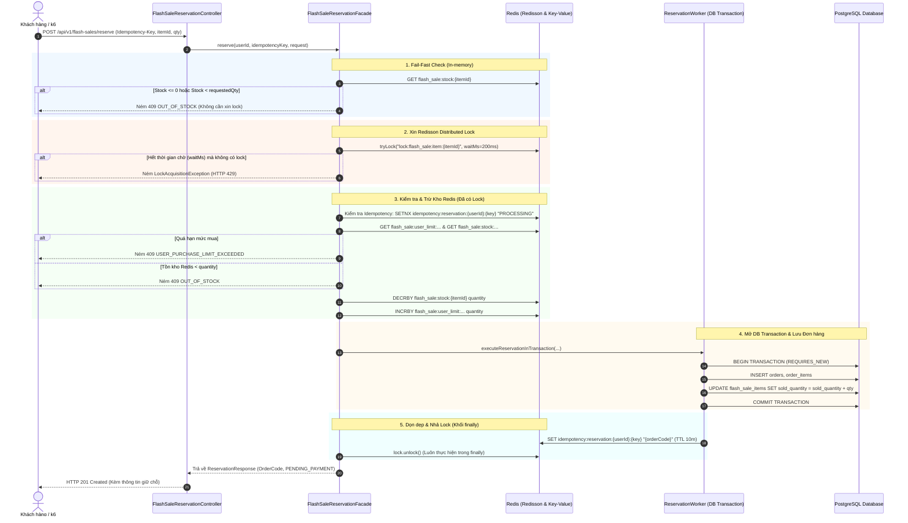

# 01. Tổng quan Khóa Phân Tán (Redisson Distributed Lock)

**Ngày cập nhật**: 05/11/2026  
**Dự án**: Flash Sale B2C UTC2  

---

## 1. Bài toán Nghiệp vụ

Trong các đợt Flash Sale, lưu lượng truy cập mua hàng có thể tăng đột biến lên hàng trăm, hàng ngàn request trong cùng một giây hướng vào một sản phẩm có số lượng giới hạn (ví dụ: tồn kho 100 sản phẩm nhưng có 10.000 requests trong 10 giây).

Nếu không có cơ chế đồng bộ và bảo vệ kiểm soát truy cập đồng thời, hệ thống sẽ gặp các vấn đề nghiêm trọng:
1. **Bán quá số lượng tồn kho (Over-selling / Race Condition)**: Nhiều transaction đọc cùng một số lượng tồn kho khả dụng từ Database và cùng thực hiện trừ kho, dẫn đến số đơn hàng tạo ra vượt xa số lượng hàng thực tế.
2. **Vi phạm giới hạn mua trên mỗi người dùng (Purchase Limit)**: Người dùng có thể cố tình hoặc vô tình gửi song song nhiều request để mua vượt quá mức trần quy định cho mỗi tài khoản trong một khung giờ Flash Sale.
3. **Nghẽn Database Connection & Lock Wait Timeout**: Nếu đẩy toàn bộ lượng concurrency cao trực tiếp xuống Database thông qua cơ chế khóa dòng quan hệ (`SELECT ... FOR UPDATE`), hàng loạt connection sẽ bị giữ chặt, dẫn đến cạn kiệt Connection Pool (HikariCP) và lỗi timeout diện rộng.

---

## 2. Phương án Kiến trúc Đã Chọn & Các Lựa chọn Trong Hệ Thống

Hệ thống cung cấp kiến trúc linh hoạt theo trục chiến lược (Strategy Pattern), được quản lý bởi `FlashSaleReservationFacade`:

### 2.1. Phương án Redisson Distributed Lock (Chủ đạo của tài liệu này)
- **Cơ chế**: Sử dụng Redisson client để tạo Distributed Lock dạng ReentrantLock trên Redis bao ngoài logic kiểm tra/trừ kho và database transaction:
  - Key lock: `lock:flash_sale:item:{itemId}`
  - Thời gian chờ xin lock (`waitMs`): Mặc định `200ms` (cấu hình qua `flashsale.lock.wait-ms:200`).
  - Khóa fail-fast: Nếu không xin được lock trong `waitMs`, hệ thống ngắt ngay lập tức và trả về ngoại lệ `LockAcquisitionException` (HTTP 429), tránh tích lũy hàng đợi làm treo server.
  - Tồn kho Redis và User Limit được cập nhật trong phạm vi được bảo vệ bởi khóa, sau đó DB transaction mới được thực thi và commit.
- **Lý do chọn**:
  - Đảm bảo tính tuần tự tuyệt đối (Strict Serialization) trên từng sản phẩm Flash Sale mà không phụ thuộc vào cơ chế khóa bi quan của từng database node.
  - Tách rời việc xếp hàng xử lý ra Redis in-memory thay vì ép PostgreSQL phải gánh hàng nghìn lock hàng đợi ở tầng row-level.
  - Đảm bảo an toàn không xảy ra over-selling (tổng số đơn tạo ra trong database luôn chính xác bằng số lượng tồn kho, các request vượt ngưỡng bị từ chối 409 hoặc 429).

### 2.2. Các phương án khác trong codebase (Hiện diện thực tế)
1. **Lua Script Stock Reservation (`LuaScriptStockReservationStrategy`)**:
   - Hiện diện tại: `src/main/java/com/b2c/flash_sale_b2c_UTC2/flashsale/strategy/LuaScriptStockReservationStrategy.java`
   - Kích hoạt khi: `flashsale.reservation.strategy=lua` (đây là chiến lược mặc định trong profile chuẩn).
   - Cơ chế: Thực hiện trừ tồn kho Redis và kiểm tra user limit bằng Lua script nguyên tử (`EVALSHA`) chỉ với 1 round-trip mạng, sau đó mới vào DB lưu đơn.
2. **Mô hình luồng giao dịch DB (Transaction Flow)**:
   - **Legacy Flow (`flashsale.tx-flow: legacy`)**: Toàn bộ chu trình từ lúc giữ chỗ Redis đến tạo Order và OrderItems nằm trong một transaction dài (`@Transactional` bao trùm phương thức `createReservation`).
   - **Optimized Flow (`flashsale.tx-flow: optimized`)**: Phân tách logic qua `GatedReservationTransactionalWorker` (`Propagation.REQUIRES_NEW`), chỉ mở transaction DB ở giai đoạn ngắn nhất có thể, dời WebSocket broadcast ra sau khi commit nhằm rút ngắn thời gian giữ Redisson lock (`hold duration`).
3. **Async Redis Stream Reservation (Chế độ bất đồng bộ)**:
   - Cấu hình qua: `flashsale.reservation.mode=async`.
   - Cơ chế: Đẩy sự kiện vào Redis Stream và trả về ngay kết quả giữ chỗ tạm thời (`PENDING_CONFIRMATION`), tách hoàn toàn việc ghi DB sang consumer nền.

---

## 3. Sơ đồ Luồng Xử Lý Request (Redisson Distributed Lock)

Dưới đây là luồng xử lý chi tiết một request giữ chỗ/mua hàng Flash Sale khi chạy với Redisson Distributed Lock:

---

## 4. Nguồn Tham Chiếu
- `src/main/java/com/b2c/flash_sale_b2c_UTC2/flashsale/service/FlashSaleReservationFacade.java:63-140`
- `src/main/java/com/b2c/flash_sale_b2c_UTC2/flashsale/strategy/RedissonLockStockReservationStrategy.java:31-68`
- `src/main/java/com/b2c/flash_sale_b2c_UTC2/flashsale/service/GatedReservationTransactionalWorker.java:43-138`
- `src/main/java/com/b2c/flash_sale_b2c_UTC2/flashsale/service/FlashSaleReservationService.java:92-185`
- `src/main/resources/application-loadtest.yaml:45-51`
